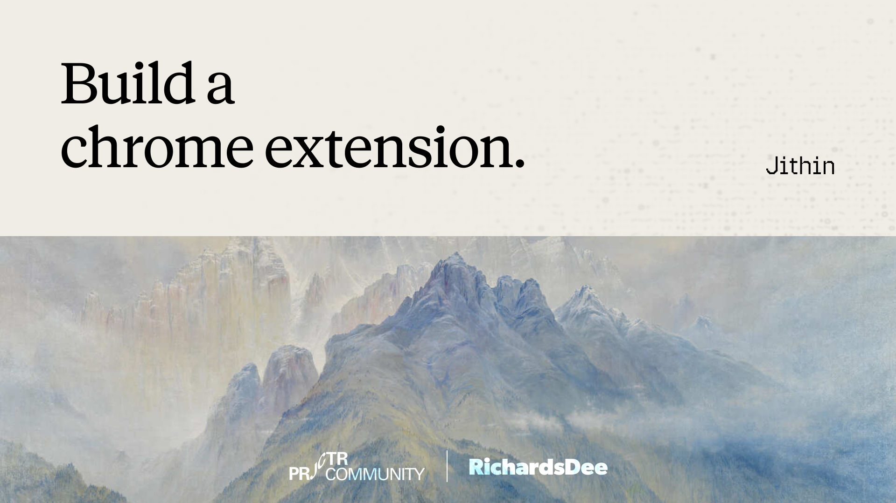

**Vibe Coding Club × Projctr Community · Dublin**

Tonight you'll build a Chrome extension that replaces the boring new tab page with something that's yours: a dashboard, a to-do list, a daily dose of cat pictures, whatever you can imagine. You don't need to know how to code. You point an AI at a folder, describe what you want, and it writes the code straight into that folder.

Everything you need is on this page, in the order you'll do it. Every grey box is a prompt: hover over it and click the copy button in the corner.

---

## Contents

**Set up**

1. [Install Chrome](#1-install-chrome)
2. [Install your AI tool](#2-install-your-ai-tool)
3. [Get the workshop files](#3-get-the-workshop-files)
4. [Pick your path and build](#4-pick-your-path-and-build)
5. [Load it into Chrome](#5-load-it-into-chrome)

**Build**

6. [Add your own features](#6-add-your-own-features)
7. [When it breaks](#7-when-it-breaks)
8. [Make it look good](#8-make-it-look-good)
9. [Understand what you built](#9-understand-what-you-built)
10. [Level up](#10-level-up)
11. [Stuck for ideas?](#11-stuck-for-ideas)

**More**

12. [Tools and models](#12-tools-and-models)
13. [After tonight](#13-after-tonight)

---

## 1. Install Chrome

You need **Google Chrome** on a laptop (Mac, Windows or Linux). If you don't have it, download it from [google.com/chrome](https://www.google.com/chrome/).

---

## 2. Install your AI tool

You need an AI tool that works inside a folder on your computer: you open a folder, describe what you want, and it writes the files for you.

### Already paying for one? Use it.

If you have a paid plan for any of these, use that tonight. They all work with every prompt on this page.

- **[Claude Code](https://docs.claude.com/en/docs/claude-code/overview)** (Claude Pro or Max)
- **[Cursor](https://cursor.com/download)** (Cursor Pro)
- **[Codex](https://openai.com/codex/)** (ChatGPT Plus or Pro)

Install it, sign in, and skip ahead to [Get the workshop files](#3-get-the-workshop-files).

### No paid plan? Use OpenCode (free)

[OpenCode](https://opencode.ai) is an open-source AI coding tool, similar to Claude Code. It offers free models, so you won't run out of credits halfway through the night.


#### Step 1: Install the OpenCode app

The desktop app is the easiest way in: no terminal needed.

1. Go to [opencode.ai/download](https://opencode.ai/download)
2. Download the desktop app for your computer:
   - **Mac:** pick **Apple Silicon** if your Mac is from 2021 or later (M1, M2, M3, M4…), otherwise **Intel**. Not sure? Click the Apple menu → **About This Mac** and look at "Chip".
   - **Windows:** download the Windows installer.
3. Install it:
   - **Mac:** open the `.dmg` file and drag OpenCode into your **Applications** folder.
   - **Windows:** run the installer and follow the steps.
4. Open OpenCode.
   - **Mac:** if it says the app can't be opened, go to **System Settings → Privacy & Security**, scroll down, and click **Open Anyway**.

<details>
<summary><b>Prefer the terminal?</b> (click to open)</summary>

Mac or Linux:

```
curl -fsSL https://opencode.ai/install | bash
```

Mac with Homebrew:

```
brew install anomalyco/tap/opencode
```

Windows (with Scoop):

```
scoop install opencode
```

Then go to your project folder in the terminal and run `opencode`.

</details>

#### Step 2: Turn on the free models

1. Go to [opencode.ai/zen](https://opencode.ai/zen) and sign up with your **GitHub** or **Google** account.
2. In the dashboard, click **Create API Key**, give it any name, and click **Create**.
3. **Copy the key straight away.** It starts with `sk-` and isn't shown again once you close the box. Paste it into a note for now.
4. In OpenCode, type `/connect` in the message box and press Enter.
5. Choose **OpenCode** (Zen) from the list and paste your key.

> **Never share your API key** or paste it into a prompt. It's like a password for your account.

#### Step 3: Pick a free model

1. In OpenCode, type `/models` and press Enter (or click the model name near the message box).
2. Choose **GLM 5.3 Flash Free** or **DeepSeek V4.1 Flash Free**. Anything marked **Free** costs nothing.
3. Check it works: type `Say hello` and press Enter. If you get a reply, you're ready.

If one free model is slow or gives odd answers, switch to the other one. You can switch any time without losing your work.

---

## 3. Get the workshop files

The workshop files include a ready-made base extension (Path B below). Even if you build from scratch, it's handy to have, so you can compare when something goes wrong.

Pick **one** of these two options.

### Option 1: Download the ZIP

1. At the top of [this repo's page](https://github.com/jithin-sabu/prjctr-workshop), click the green **Code** button.
2. Click **Download ZIP**.
3. Find the downloaded file (usually in your **Downloads** folder): `prjctr-workshop-main.zip`.
4. Unzip it:
   - **Mac:** double-click the file.
   - **Windows:** right-click it → **Extract All** → **Extract**.
5. Move the unzipped `prjctr-workshop-main` folder somewhere easy to find, like your **Desktop** or **Documents**.

Inside you'll find:

```
prjctr-workshop-main/
├── README.md          ← this guide
└── base-extension/    ← the ready-made base for Path B
```

### Option 2: Ask your AI tool to get them

1. Make a new empty folder somewhere easy to find, like your Desktop, and call it `workshop`.
2. Open that folder in your AI tool:
   - **OpenCode app:** click **Open project** (or **Open folder**) and choose `workshop`.
   - **Cursor:** **File → Open Folder** and choose `workshop`.
   - **Claude Code or Codex:** open the `workshop` folder the same way you'd open any project.
3. Copy this prompt, paste it in, and send it:

```
Download the files from this GitHub repo into this folder:
https://github.com/jithin-sabu/prjctr-workshop

If git is installed, clone it. If not, download the ZIP from
https://github.com/jithin-sabu/prjctr-workshop/archive/refs/heads/main.zip
and unzip it here.

When you're done, tell me the full path to the "base-extension" folder, and list what's inside it. Don't change any of the files.
```

4. Approve the steps when the AI asks. When it's finished, it tells you where the `base-extension` folder is.

> **The AI will ask before it runs commands or creates files.** That's normal. Read what it wants to do, and approve it.

---

## 4. Pick your path and build

### Path A: Start from scratch (recommended)

You'll learn the most by building the whole thing yourself.

1. Make a new empty folder somewhere easy to find, like your Desktop, and call it `my-new-tab`.
2. Open that folder in your AI tool (the same way as in [Option 2](#option-2-ask-your-ai-tool-to-get-them) above).
3. Copy this prompt, change the parts in `[brackets]`, and send it:

```
Build me a Chrome extension in this folder that replaces Chrome's new tab page with my own custom page. I'm not a programmer, so keep it simple:
- Plain HTML, CSS and JavaScript only. No frameworks, no libraries, no build step, nothing to install.
- Put all JavaScript in a separate .js file. No inline <script> code and no onclick="" attributes, because Chrome blocks those in extensions.

What the page shows:
1. A greeting that changes with the time of day ("Good morning", "Good afternoon", "Good evening"), followed by my name: [YOUR NAME]. Put the name in a clearly labelled variable at the top of the JS file so it's easy to change.
2. A large clock (hours and minutes) that stays up to date, with today's date underneath.
3. A row of 4 quick-link tiles: [Gmail, YouTube, GitHub, Google Maps], each with the site's name underneath. Use each site's real icon: download its favicon into an "icons" folder inside this extension and show that on the tile. Don't use emoji. If an icon can't be downloaded, show the site's first letter instead.
4. Below that, an empty card with a dashed border that says "✨ Your idea goes here". This is a placeholder for features I'll add later.

How it looks:
- Calm, modern and minimal. Everything centred, a soft gradient background, a clean system font, gentle rounded corners.
- It should look good on a small laptop screen and a big monitor.

Technical:
- Manifest V3, using chrome_url_overrides to replace the new tab.
- No permissions in the manifest.
- Name the extension "My New Tab".
- Keep the code tidy, with short comments explaining each part, so I can add features later.

When you're done, list the files you created in one line each, then tell me step by step how to load the extension in Chrome and how to see my changes after you edit something.
```

4. Approve the changes when the AI asks, then go to [Load it into Chrome](#5-load-it-into-chrome).

**Want to start from your own idea instead?** Use this prompt in step 3:

```
I want to build a Chrome extension in this folder that replaces Chrome's new tab page. I'm not a programmer.

My idea: [describe what you want to see every time you open a new tab]

Before you build anything, ask me up to 5 questions to understand what I want. Then suggest the simplest first version, and wait for me to say go.
```

### Path B: Start from the base

If you'd rather skip ahead, start from the ready-made base in the workshop files.

1. Find the `base-extension` folder from [Get the workshop files](#3-get-the-workshop-files). Copy it somewhere easy to find, like your Desktop, so you keep an untouched original.
2. Open your copy of `base-extension` in your AI tool.
3. [Load it into Chrome](#5-load-it-into-chrome) to see what it looks like.
4. Send this first prompt, so the AI gets to know the project:

```
This folder is a Chrome extension (Manifest V3) that replaces the new tab page. I'm not a programmer.
Look through all the files, then explain in a few plain-English sentences what each one does.
Then change the name in the greeting to [YOUR NAME].
From now on, keep all JavaScript in .js files, with no inline scripts or onclick="" attributes.
```

<details>
<summary><b>The prompt that built the base</b> (click to open)</summary>

```
Build me a Chrome extension in this folder that replaces Chrome's new tab page with my own custom page. I'm not a programmer, so keep it simple.

What the page shows:
1. A greeting that changes with the time of day ("Good morning", "Good afternoon", "Good evening"), followed by my name: [YOUR NAME]. 
2. A large clock (hours and minutes) that stays up to date, with today's date underneath.
3. A row of 4 quick-link tiles: [Gmail, YouTube, GitHub, Google Maps], each with the site's name underneath. Use each site's real icon: download its favicon into an "icons" folder inside this extension and show that on the tile. Don't use emoji. If an icon can't be downloaded, show the site's first letter instead.
4. Below that, an empty card with a dashed border that says "✨ Your idea goes here". This is a placeholder for features I'll add later.

How it looks:
- Calm, modern and minimal. Everything centred, a clean system font, gentle rounded corners.

Technical:
- Name the extension "My New Tab".
- Keep the code tidy, with short comments explaining each part, so I can add features later.

```

</details>

---

## 5. Load it into Chrome

1. Open a new tab and go to `chrome://extensions`
2. Turn on **Developer mode** (switch in the top-right corner)
3. Click **Load unpacked** and choose your extension folder: `my-new-tab` for Path A, or your copy of `base-extension` for Path B. Pick the folder itself, not a file inside it.
4. Open a new tab 🎉
5. Chrome may ask *"Change back to Google?"* or *"Keep this change?"*. Choose **Keep it**.

**Every time the AI changes something:** go back to `chrome://extensions`, click the **↻ reload** arrow on your extension, then open a fresh new tab.

> **Not seeing your page?** Only one extension can control the new tab at a time. If you already have one (Momentum, Tabliss, etc.), switch it off on `chrome://extensions`.

---

## 6. Add your own features

The golden rule: **one feature at a time.** Ask for one thing, reload, check it works, then ask for the next. Big wish lists in one prompt are where things go wrong.

**Add a feature:**

```
Add [feature] to my new tab page.
It should: [what it does, step by step from the user's point of view]
Put it [where on the page, e.g. replacing the "Your idea goes here" card].
Keep everything else working exactly as it is.
```

**Example: a to-do list** (this is what we build in the live demo):

```
Replace the "✨ Your idea goes here" card with a to-do list:
- Type a task and press Enter to add it
- Click a task to tick it off (strikethrough), click × to delete it
- Tasks are saved, so they're still there next time I open a new tab (use localStorage so no extra permissions are needed)

Keep the same look and feel.
```

**Got a big idea? Plan it first:**

```
I want to add [big idea] to my new tab extension.
Don't change any files yet. Break this into 3–5 small steps we can build and test one at a time, starting with the simplest version that's still useful.
```

**Remember things between tabs:**

```
I want [the thing] to be remembered when I close the tab and open a new one. Use localStorage.
```

---

## 7. When it breaks

It *will* break at some point. That's normal, and fixing it is half the skill. The AI is very good at fixing its own mistakes if you show it what went wrong.

### Where to find the error

- **On `chrome://extensions`**, look for a red **Errors** button on your extension. Click it and copy the message.
- **On your new tab page**, right-click anywhere → **Inspect** → **Console** tab. Red text is an error.
- **Chrome won't load the folder at all?** Copy the error message from the popup.

### Prompts for fixing

**You have an error message:**

```
I got this error in Chrome:

[paste the error]

Explain in one sentence what went wrong, then fix it.
```

**Nothing happens / it doesn't do anything:**

```
I reloaded the extension, but when I [what you did], [what happened] instead of [what you expected].
There's no error on chrome://extensions. Look through the code, find the bug and fix it.
```

**It looks wrong:**

Take a screenshot (Mac: `Cmd + Shift + 4`, Windows: `Win + Shift + S`), attach it, and say:

```
Here's a screenshot of my new tab page. The problem: [what looks wrong]. It should look like: [what you want]. Fix it.
```

**It was working, and the last change broke it:**

```
Your last change broke [what stopped working]. Before that change, everything worked.
Fix it without removing the new feature. If that's not possible, undo the last change.
```

> **Make a backup whenever something works.** Ask the AI: *"Make a copy of the whole extension in a folder called backup-1, next to this one."* If you get really stuck, you can always go back.

**Nothing changed after the AI said it was done:**

```
You said you changed [thing], but I reloaded the extension and I don't see it. Check that the files in this folder actually contain the change, and tell me which file and line it's in.
```

**It's going around in circles:**

Long chats make the AI confused. Start a fresh chat in the same folder (your files stay where they are) and send:

```
This folder is my Chrome extension that replaces the new tab page. Read all the files first.
The problem: [what's wrong]. What I've already tried: [what you asked before].
Find the cause and fix it.
```

If the same tool still can't fix it, open the folder in a different AI tool. A second opinion often sees the problem straight away.

### Common problems

| What you see | What's probably wrong |
|---|---|
| "Manifest file is missing or unreadable" | You picked the wrong folder on Load unpacked. Pick the folder that has `manifest.json` in it |
| "Refused to execute inline script" | JavaScript is inside the HTML. Ask the AI to move it into a separate `.js` file |
| The normal Google new tab still shows | Another new-tab extension is active, or you clicked "Change it back" |
| Your changes don't show up | You didn't click ↻ reload on `chrome://extensions`, or you're looking at an old tab |
| Page is blank | Open Inspect → Console and paste the red error into the AI |

---

## 8. Make it look good

**A whole new style:**

```
Redesign my new tab page in this style: [e.g. cosy and warm / retro 90s computer / dark and futuristic / like a Japanese stationery shop].
Change only the look (colours, fonts, spacing, backgrounds). Don't change what anything does.
```

**Dark mode:**

```
Add a dark mode that turns on automatically when my computer is in dark mode, plus a small button to switch it manually. Remember my choice with localStorage.
```

**A theme for every day:**

```
Give my page a different background colour and greeting style for each day of the week, chosen automatically.
```

**Make it feel alive:**

```
Add a few subtle animations: things fading in gently when the page opens, and a soft hover effect on buttons and links. Keep it calm, nothing flashy.
```

**Use a picture:**

Put a photo in your extension folder and name it `background.jpg`, then:

```
Use background.jpg in this folder as the page background, with a dark overlay so the text stays readable.
```

---

## 9. Understand what you built

You don't have to understand code to build things, but a little understanding makes you much better at asking for what you want.

```
Explain what each file in this folder does, in plain English, as if I've never seen code before. Keep it short.
```

```
Walk me through what happens, step by step, from the moment I open a new tab until the page is showing.
```

```
I want to change [small thing, e.g. the greeting text or the colour of the clock] myself, without asking you. Which file and which line do I edit?
```

---

## 10. Level up

Finished early? Try something more ambitious.

**Live data from the internet:**

```
Add the current weather for [your city] to my new tab page, using the free Open-Meteo API (no API key needed).
Update manifest.json so the extension is allowed to fetch from it, and explain what you changed.
```

**A popup button in the toolbar:**

```
Add a popup to my extension: when I click its icon in the Chrome toolbar, a small window opens that [does something, e.g. lets me add a to-do to my new tab list].
Explain what you're adding to manifest.json and why.
```

**Do something on the website you're on:**

```
I want my extension to also work on normal websites: [e.g. a button in the popup that turns the current page into dark mode / highlights a word everywhere on the page].
Explain what permissions this needs and why before you add them.
```

**Share it with a friend:**

```
How can I share this extension with a friend so they can install it too? Explain the simplest way, and what it would take to publish it on the Chrome Web Store.
```

---

## 11. Stuck for ideas?

Pick one, or mix a few together.

**🟢 Easy (one prompt)**
- A quote of the day (or a random one each tab)
- A countdown to a holiday, a trip, or Friday
- A random dog, cat or fox picture every tab
- Your quick links, but beautiful
- A daily affirmation, or a daily roast for opening yet another tab

**🟡 Medium (a few prompts)**
- A to-do list that remembers your tasks
- A focus timer (Pomodoro) with a little sound at the end
- Sticky notes you can type on
- A habit tracker: tick off today's water, walk, reading
- A "tabs opened today" counter that judges you
- A word of the day in a language you're learning

**🔴 Ambitious**
- Weather for your city
- A tiny game for when you should be working
- A mood journal with a chart of the last 30 days
- A popup that saves the page you're on to a reading list on your new tab
- A new tab that changes completely based on the time of day (focus in the morning, calm at night)

**Still stuck? Ask the AI:**

```
I'm building a custom new tab page as a Chrome extension. Here's a bit about me: [hobbies, job, what you do every day].
Suggest 10 fun or useful things I could put on it, from easy to ambitious. Don't build anything yet.
```

---

## 12. Tools and models

Every tool on this page works the same way: you open a folder, describe what you want, and it writes and edits the files for you. Use a paid tool (Claude Code, Cursor, Codex) if you have one, or OpenCode with its free models. Setup is in [Install your AI tool](#2-install-your-ai-tool).

A few things that help:

- **Pick a good model.** In paid tools, use the best one your plan gives you. In OpenCode, use **GLM 5.3 Flash Free** or **DeepSeek V4.1 Flash Free** (type `/models` to switch).
- **Stuck on a bug? Switch models.** A different model often spots the problem straight away. Your files stay where they are.
- **If your tool offers a "thinking" or "reasoning" mode**, turn it on when something's broken. It's slower but better at finding bugs.
- **Your files live in the folder, not the chat.** So you can open the same folder in another tool and carry on.
- **Paid plan running low?** Switch to OpenCode's free models for the rest of the night.

---

## 13. After tonight

- **Keep using it.** You'll notice what's missing within a day, and that's your next prompt.
- **Share what you built** with the club. A screenshot is enough.
- **Try a different kind of extension next**, one that changes websites you visit, or a popup tool for something you do every day.

Built with ❤️ for the Vibe Coding Club Dublin.
